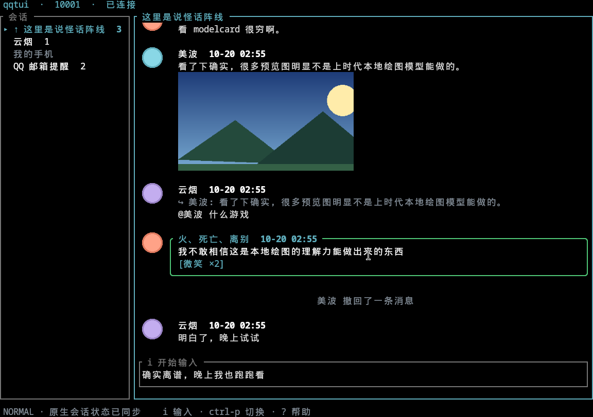

# qqtui

在终端里使用 QQ。

直接驱动本机安装的官方 QQ 客户端。消息收发、会话顺序、未读数都通过 QQ 原生服务完成，登录、设备信息和账号安全也完全由官方客户端处理。

## 特性

- Vim 模态操作与自定义按键
- Kitty 行内图片与动图（GIF / APNG / WebP）
- 表情包、表情回应、合并转发、引用跳转等完整消息体验
- 多账号：每个窗口一个账号
- 桌面通知，点击跳转到对应消息
- 中文输入法智能切换（Fcitx5 / IBus / Windows IME）

## 安装

支持 Linux x86_64，推荐 Kitty 终端（行内图片）。

从 AUR 安装预编译包 [qqtui-bin](https://aur.archlinux.org/packages/qqtui-bin) 或源码包 [qqtui](https://aur.archlinux.org/packages/qqtui)：

    yay -S qqtui-bin

其他发行版与手动打包见 [构建指南](CONTRIBUTING.md#arch-打包)。

## 使用

退出正在运行的桌面 QQ（同一数据目录不能同时运行两个实例），然后：

    qqtui

选择账号后会打开一个临时 QQ 登录页面，完成登录后回到终端按 Ctrl+C 关闭页面，进入聊天。

- `i` 输入，Enter 发送，Alt+Enter 换行，Esc 返回导航
- `j/k` 选择会话，Enter 打开，`Ctrl+P` 搜索切换
- `r` 回复，`v` 预览图片，`o` 打开图片／文件／链接
- `?` 查看全部按键，`q` 退出（QQ 保持在线）

更多操作、配置项和后台管理命令见[使用指南](docs/USAGE.md)。

## 工作原理

完整的官方 QQ 在独立的 Xvfb 显示里运行，窗口、托盘和桌面通知都隔离在该环境中。TUI 通过本机 Unix Socket 与注入 QQ 的桥接插件交换 JSON-RPC，会话与消息状态以 QQ 原生服务为准，TUI 只保留离线可读的缓存与草稿。

## 文档

- [使用指南](docs/USAGE.md)：按键、配置、后台管理
- [架构](docs/ARCHITECTURE.md)：状态归属、同步与恢复、发送一致性
- [桥接协议](docs/PROTOCOL.md)：Unix Socket 上的 JSON-RPC 接口
- [CONTRIBUTING](CONTRIBUTING.md)：开发检查与打包

## 致谢

- [NapCatQQ](https://github.com/NapNeko/NapCatQQ)：QQ 原生接口研究参考
- [napcat-linux-launcher](https://github.com/NapNeko/napcat-linux-launcher)：Linux 加载器参考
- [QQNT-Toolbox](https://github.com/MeiYongAI/QQNT-Toolbox)：转发图片资源处理参考
- [Concord](https://github.com/chojs23/concord)、[iamb](https://github.com/ulyssa/iamb)、[nchat](https://github.com/d99kris/nchat)：布局与交互参考

## 许可证

第一方代码采用 [MPL 2.0](LICENSE)。
